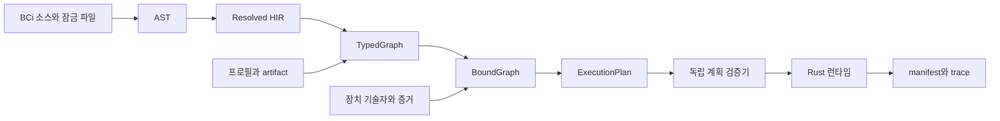

# 컴파일러, 중간 표현과 진단

근거: [원문 컴파일 산출물](../../bci_dsl_latex/sections/10_conformance.tex). 목표 구현은 Rust workspace이며 소스 언어와 host API의 버전을 독립 관리한다.

## 전체 구조



## crate 책임

아래 이름은 논리적 책임을 나타낸다. 실제 workspace는 [아키텍처 문서](../architecture.md)의 대응표에 따라 source·check·plan을 bci-compiler의 파일로, profile을 bci-devices의 파일로 배치한다. 공유 계약·SDK·독립 검증·실행·저장 경계는 각각 형제 패키지로 유지한다.

| crate | 소유 데이터·기능 | 의존 방향 |
|---|---|---|
| `bci-source` | 파일 ID, span, lexer, parser, syntax tree | 기초 crate |
| `bci-schema` | unit, quantity, channel, clock, 품질 | 기초 crate |
| `bci-ir` | HIR, TypedGraph, BoundGraph, plan schema | source/schema |
| `bci-check` | 타입, 효과, 정적 제약, obligation | ir와 registry 서명 |
| `bci-operators` | 연산자 계약, 참조 구현, kernel registry | schema |
| `bci-extension` | pointwise/stateful SDK, context·codec·wrapper API | schema와 operator contract |
| `bci-extension-macros` | Rust 등록 속성, wrapper·registry 생성 | extension SDK 계약 |
| `bci-profile` | 장치 프로필, binding 판정 | schema와 제약 API |
| `bci-plan` | SDF·사건 영역 분할, 메모리, 일정 | typed/bound IR |
| `bci-verify` | 계획 증명서의 독립 검사 | plan schema |
| `bci-runtime` | actor, mailbox, pool, supervisor | 검증된 plan |
| `bci-adapter-*` | 장치별 FFI·decoder·probe | adapter API |
| `bci-artifact` | hash, manifest, trace, 모델·계수 codec | 공통 schema |
| `bci-cli`, `bci-lsp` | 명령, 진단, 언어 도구 | 공개 compiler API |

IR crate는 adapter의 native SDK에 의존하는 필드를 opaque descriptor로 받는다. 이 경계로 source check와 실제 장치 연결을 독립 실행할 수 있다.

crate 경계는 논리적 책임을 나타내며 독립 패키지 배포 여부는 workspace 구성이 정한다. 일반 프로그래밍 구문은 확장 crate의 Rust 컴파일 과정에서 처리한다. BCi 프런트엔드는 [13](13-rust-extensions.md)의 생성된 registry를 읽고 호출 경계의 계약을 검사한다.

OperatorSpec의 공유 데이터 정의는 bci-schema가 소유하고, 표준 커널 구현과 등록 목록은 bci-operators가 소유한다. bci-extension은 이 공유 계약과 등록 매크로에 연결한다. 실제 커널·장치 구현체는 CLI 또는 runtime bundle이 조립해 주입한다.

## IR별 계약

AST는 모든 token span, 원래 숫자·단위 표기, 선언과 인수를 보존한다. parse error 복구는 세미콜론·최상위 선언·닫는 괄호를 동기화 지점으로 사용한다. 오류 노드는 별도 kind로 표시한다.

Resolved HIR은 symbol ID, import lock, artifact reference, pipe 전개, graph instance를 가진다. call마다 고유 instance ID를 생성하고 source expansion stack을 기록한다. static evaluation은 유한 배열·레코드·상수 산술·등록한 순수 생성자로 제한한다. 평가 비용은 compiler budget으로 계량한다.

호출 symbol은 DescriptorConstructor, GraphConstructor, RuntimeOperator로 구분한다. descriptor 생성은 compiler가 제공하는 제한된 상수 평가 기능을 사용하고, RuntimeOperator는 IR 노드를 만든 뒤 실행 시 Rust kernel을 호출한다. 사용자 Rust 도구가 생성한 `.bci`와 artifact도 동일 검사 경로를 거친다.

```text
TypedNode {
  node_id, operator_id, operator_version, source_span, expansion_stack,
  inputs: PortId[], outputs: TypedPort[], parameters: ConstantRecord,
  effect, support_transform, quality_transform,
  state_contract, provenance_rule, obligations: ObligationId[]
}
TypedEdge { producer, consumer, full_type, metadata_contract }
```

BoundGraph는 profile instance, config, resolved descriptor, binding evidence, 실제 schema와 rate를 포함한다. `Exists` 포트를 구체화할 때 원래 타입 조건을 재검사한다. 구성 변화는 새 graph digest를 만든다.

ExecutionPlan은 actor instance, kernel 선택, startup prologue, steady schedule, event boundary, buffer/pool, memory budget, thread allocation, fault route, transition protocol, evidence IDs를 가진다. 포트에서 source span까지의 역추적 표를 유지한다.

## 검사 순서와 실패 전달

1. 구문·이름·kind를 확인하고 정규화 상수와 schema를 생성한다.
2. 포트 타입, 단위, rate, effect를 추론한다. 연결 오류는 양쪽 포트를 함께 표시한다.
3. graph cycle, delay 초기값, fit 역할과 provenance 흐름을 검사한다.
4. 프로필·환경 조건을 결합하고 Pass/Fail/Pending을 산출한다.
5. 시간 support, 창 완결, 수치 guard, 자원 의무를 노드에 부착한다.
6. bound 조건에서 실행 계획을 생성하고 독립 검증기가 증명서를 다시 계산한다.

앞선 오류로 의미가 정해지지 않은 포트는 Poison 타입을 부여한다. 후속 진단은 해당 원인 ID에 연결하여 같은 오류의 반복 출력을 통합한다. 독립 branch의 오류는 계속 수집한다.

## 제약 풀이

정적 풀이의 기초 영역은 checked 정수 선형 산술, 유리수 비교, 유한 집합·명목 ID equality다. `C*N*bytes` 같은 곱은 구체화한 정수에서 checked 연산한다. 기호 곱을 포함한 자원식을 계산하려면 bind 값의 구체화 obligation을 요구한다.

solver 결과는 `Satisfied`, `Unsatisfied(core)`, `Unknown(requirements)`다. Unknown은 Pending으로 전달한다. 수치 행렬 조건은 artifact verifier 또는 runtime guard로 연결한다. 모순된 환경 가정은 `E0802 InconsistentAssumptions`이며 implication 증거로 사용할 때 먼저 SAT를 확인한다.

각 증거는 대상 predicate의 digest, 입력 artifact digest, solver/검증기 version, 적용 domain을 갖는다. 캐시는 이 전체 tuple을 key로 사용한다.

## 최적화와 관측 보존

| 변환 | 적용 조건 | 보존할 관측 |
|---|---|---|
| 상수 접기 | 정규화 유리수와 명시적 float 변환 | 값·반올림 계약 |
| 순수 노드 공통화 | operator/config/schema/effect 동일 | lineage와 consumer 품질 |
| 연속 단위 변환 결합 | exact affine 합성과 numeric 허용오차 | 단위·변환 계보 |
| FIR/특징 kernel fusion | 의미·상태·quality 동등 증거 | support, warmup, numeric contract |
| 불변 block 공유 | consumer lifetime 상한과 pool 계산 | 값과 원천 ID |
| dead node 제거 | sink·fit·외부 효과 의존성 밖의 노드 | 관측·분할 계보 |

상태를 가진 연산자 호출은 개별 instance identity를 유지한다. activation·watermark·gap·epoch barrier는 순서 fence다. fusion 실행은 원래 논리 노드별 lineage를 유지하고 물리 완료 경계와 논리 관측 경계의 대응을 manifest에 저장한다. 시간 예산은 최종 물리 계획에서 재계산한다.

## 진단 구조

```text
Diagnostic {
  code, severity, message, primary_span,
  related_spans[], expected, actual,
  obligation_id, evidence_refs[], graph_path[], suggested_action
}
```

메시지는 원인·영향·수정 행동을 제공한다. 예: `E0204: 모델은 [C3,C4] 순서를 요구하며 입력은 [C4,C3]이다. signal.reorder로 채널 순서를 맞춘다.`

| 코드 영역 | 책임 |
|---|---|
| E01xx | 구문, 이름, 모듈 |
| E02xx | kind, 단위, schema, rate |
| E03xx | 효과, cycle, state |
| E04xx | 시계, watermark, mapping |
| E05xx | 수치 영역·연산자 |
| E06xx | 장치·binding·capability |
| E07xx | 분할·fit·model |
| E08xx | 계획·증거·자원 |
| E09xx | runtime·recording·artifact |

## 안정적인 산출물

node ID는 모듈 symbol, graph call path, 선언 위치의 구조 key에서 생성한다. artifact hash는 정규화 의미 내용에서 생성한다. 소스 공백만 바뀌면 graph digest가 유지되고 source-map digest가 갱신된다. operator 의미 버전, 타입, 계수, profile 또는 실행 정책이 바뀌면 관련 artifact digest가 바뀐다.

계획 파일은 schema version과 compiler version을 갖는다. runtime은 지원하는 plan schema와 kernel digest를 검사한 후 `VerifiedPlan`을 생성한다. 버전 불일치는 `E0901 ArtifactVersionMismatch`와 필요한 registry version을 보고한다.

사용자 kernel을 포함한 runtime bundle은 extension API 판본·Cargo lock·toolchain·target·feature set과 생성 registry의 digest를 가진다. plan의 kernel ID와 bundle의 정적 registry를 대조한다. 진단 source map은 `.bci` 호출과 Rust 함수의 위치를 함께 연결한다.
